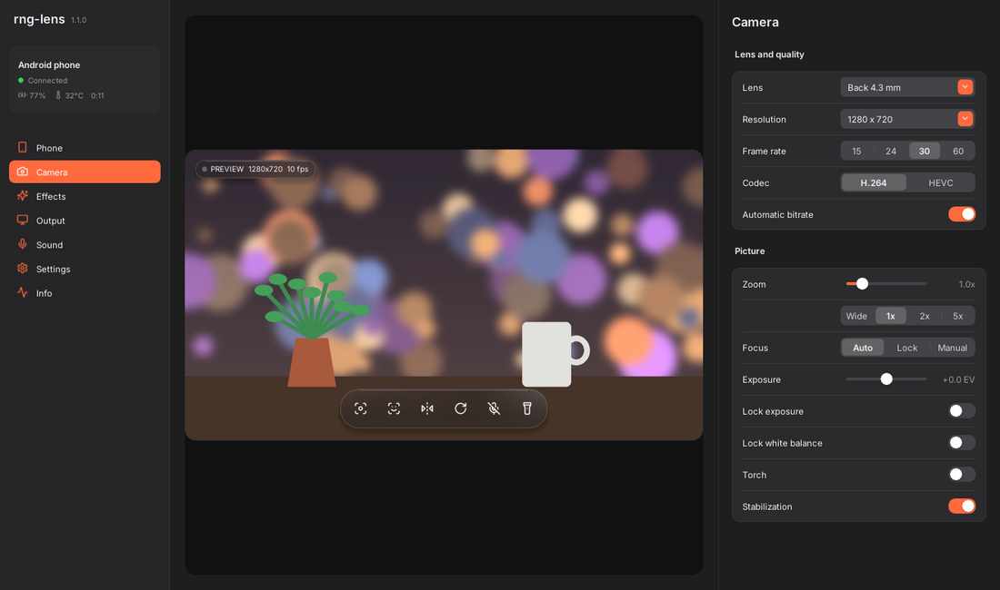

# rng-lens - use your Android phone as a webcam (free Iriun / DroidCam alternative)

Your phone as a webcam and microphone for Windows. Free, open source, no ads, no watermark, no account,
no pro version: every feature is included.

**Download:** [Windows installer](https://github.com/MRRengi/rng-lens/releases/latest/download/rng-lens-setup.exe) ·
[phone app (APK)](https://github.com/MRRengi/rng-lens/releases/latest/download/rng-lens.apk) ·
[all releases](https://github.com/MRRengi/rng-lens/releases) · [website](https://mrrengi.github.io/rng-lens/)



## How it compares

| | rng-lens | Typical free phone-webcam apps |
|---|---|---|
| Resolution | up to 4K / 60 fps | capped in the free version |
| Watermark, ads | none | often |
| Background blur, auto-frame | yes, on the PC's GPU | paid or missing |
| Overheating on long calls | heat guard steps quality down before it happens | camera drops when the phone gets hot |
| Streaming with the screen locked | yes | rarely |
| Source code | MIT | closed |

## Features

- Any app sees a camera called **rng-lens**: Zoom, Discord, OBS, Teams, Meet in Chrome
- Wi-Fi with auto-discovery, or USB through adb
- Up to 4K and 60 fps, H.264 or HEVC
- Every lens the phone exposes (ultra-wide via zoom below 1x), zoom, focus auto / lock / manual,
  exposure lock and EV, white-balance lock, torch, stabilization
- Mirror, flip, rotate, vertical and square output
- Phone microphone (Opus / AAC, "voice" with echo cancel and noise suppression, or "raw"), played on any
  output device. To make it a microphone in calls, route it through [VB-Cable](https://vb-audio.com/Cable/):
  a system microphone needs a Microsoft-signed kernel driver, which a free project can't ship
- Effects on the PC's GPU, so the phone doesn't work harder: background blur or picture, auto-frame
  (follows your face), looks (warm, cool, film, vivid, faded, b&w), brightness / contrast / saturation /
  warmth, sharpen, skin smoothing, night mode (motion-aware frame averaging)
- Heat guard: the phone watches Android's own thermal forecast and steps down fps, resolution and
  bitrate before it overheats, then back up when it cools. Battery, temperature and a temperature graph on the PC
- Keeps streaming with the phone's screen locked (screen off = coolest phone)
- Pause button ("Be right back") and a frozen frame with "Reconnecting..." if Wi-Fi drops, so calls never see a dead camera
- Exposure on your face: no silhouette with a window behind you
- Updates itself from inside the PC app
- Clean macOS-style look on the PC and the phone, light and dark with the system
- Tray icon, start with Windows, global hotkeys (Ctrl+Alt+M/R/T/B/F/P)
- Optional second phone as a second camera, "rng-lens 2"

## Why it's light on the phone

The phone does exactly two things: the camera writes straight into the hardware encoder's input
surface (no CPU copy of a single pixel), and the encoded bytes go out over TCP. No preview is
rendered, the screen blacks out at minimum brightness (or lock it: streaming goes on), and a heat
guard steps quality down before Android would throttle. Decoding, rotation, mirroring, every effect
and the background / face detection all run on the PC. If the network falls
behind, the phone drops frames until the next key frame instead of buffering.

## Layout

| Path | What |
|------|------|
| `android/` | Phone app, plain Java, no libraries. `build.sh` builds the APK without Gradle |
| `desktop/` | PC app, C++17: FFmpeg decode (GPU on Windows via D3D11VA), OpenGL effect chain, Dear ImGui, ONNX Runtime for background / face |
| `third_party/softcam/` | Windows virtual camera: [Softcam](https://github.com/tshino/softcam) rebranded (own CLSID, name "rng-lens"), builds with mingw |
| `tools/` | Test benches, FFmpeg build script, icon generator |
| `packaging/windows/` | NSIS installer and the user README |
| `site/` | Project website (GitHub Pages) and privacy policy |
| `fastlane/` | Store listing texts (F-Droid, IzzyOnDroid) |
| `.github/workflows/` | CI: builds and benches every push; a `v*` tag publishes a Release |
| `docs/SPEC.md` | Architecture and the wire protocol |

## Build

Phone (Linux):
```
sudo apt install android-sdk-platform-23 aapt dalvik-exchange zipalign apksigner
android/build.sh            # -> android/build/rng-lens.apk
```

PC, Windows build from Linux:
```
sudo apt install mingw-w64 g++-mingw-w64-x86-64-posix g++-mingw-w64-i686-posix nasm cmake nsis
tools/build-ffmpeg-windows.sh                      # -> third_party/ffmpeg-win
tools/fetch-vision.sh                              # -> third_party/vision (ONNX Runtime + models)
cd desktop
cmake -B build-win -DCMAKE_TOOLCHAIN_FILE=cmake/mingw-w64.cmake && cmake --build build-win -j
cmake -B build-win32 -DCMAKE_TOOLCHAIN_FILE=cmake/mingw-w32.cmake -DRNGLENS_VCAM_ONLY=ON && cmake --build build-win32 -j
cd .. && tools/package-windows.sh 1.0.0 [platform-tools]   # -> dist/rng-lens-setup-1.0.0.exe (needs nsis)
```

PC, Linux:
```
sudo apt install libavcodec-dev libavutil-dev libswscale-dev libswresample-dev libglfw3-dev cmake
cd desktop && cmake -B build-linux && cmake --build build-linux -j
# virtual camera: sudo modprobe v4l2loopback exclusive_caps=1 card_label=rng-lens
```

## Test benches (no phone, no Windows machine, no display needed)

- `tools/bench.sh` - FakePhone (the phone app's own protocol code + ffmpeg standing in for camera and
  encoder) against `rng-lens --headless`: discovery, H.264, live switch to 1080p, HEVC, 60 fps.
  Plus the microphone: a 440 Hz tone (Opus and AAC) must come out as 440 Hz, and the phone's heat
  guard driven through a heat-up / cool-down story.
- `tools/effects_bench.py` - the real app with the fake phone streaming a photo: each effect is measured
  against a no-effects baseline (b&w has no colour, background blur keeps the person sharp, auto-frame
  zooms in and centres the face, night mode removes grain, and so on).
- `tools/wine-bench.sh` - the Windows build under Wine with two phones: real GUI and OpenGL, both
  DirectShow cameras registered, and a DirectShow client pulling frames from "rng-lens" (64 and 32 bit)
  and "rng-lens 2".
- `tools/sound-bench.sh [linux|wine]` - the real app plays the tone into a PulseAudio null sink, recorded and checked.

## Releasing

Add three repository secrets once (Settings > Secrets and variables > Actions): `ANDROID_KEYSTORE_B64`
(base64 of the release keystore), `ANDROID_KEYSTORE_PASS`, `ANDROID_KEY_ALIAS`. Then
bump the version in `desktop/CMakeLists.txt` and push to the `release` branch (`git push origin main:release`),
or push a tag `vX.Y.Z` - CI builds, benches and publishes the Release with the tag.

## License

MIT. Softcam is MIT (see its LICENSE), Inter is OFL-1.1, Lucide icons are ISC, miniaudio is public domain / MIT-0, ONNX Runtime is MIT,
PP-HumanSeg is Apache-2.0, YuNet is MIT. FFmpeg is LGPL and linked dynamically.
